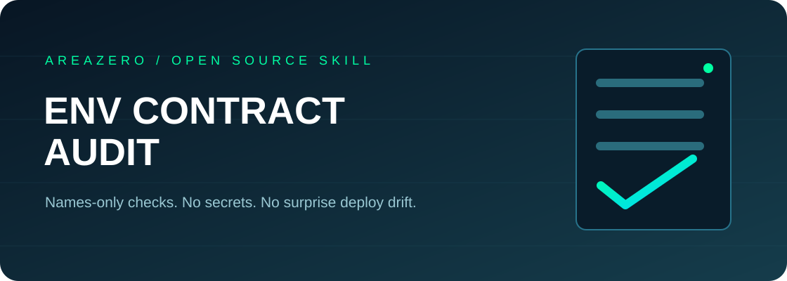

<p align="center"></p>
<p align="center"></p>

# Env Contract Audit

**Configuration drift should be caught before deployment, without exposing your secrets.** This tiny, dependency-free Agent Skill compares statically referenced environment **names** in Python, JavaScript, TypeScript, and Vite with placeholder declarations in example files. No live env data, API calls, LLM services or network dependencies are needed.

[](https://github.com/Kanompung1988/env-contract-audit/actions/workflows/ci.yml) · [Agent Skills open specification](https://agentskills.io/specification) · [Rule details](references/RULES.md) · [MIT code license](LICENSE)

## Why this matters
Teams can successfully run code locally while production deploys fail because a newly introduced environment variable was never documented for operations. Names such as `VITE_PRIVATE_TOKEN` can also indicate accidental exposure through browser-bundler prefixes. Vite explicitly documents the client exposure behavior; this tool turns that advisory into actionable review suggestions without opening your actual `.env`.

## Quickstart

```bash
git clone https://github.com/Kanompung1988/env-contract-audit.git
cd env-contract-audit
python scripts/audit.py examples/drift --format markdown --fail-on high
python scripts/audit.py /path/to/your/project --format json --check-unused
python -m unittest discover -s tests -v
```

`0` = no findings at configured threshold, `2` = threshold findings, `1` = processing error. **0 does not guarantee deployment success or no secret leaks.** The drift example intentionally exits 2.

### Install for Claude Code / Codex

```bash
mkdir -p .claude/skills
git clone --depth 1 https://github.com/Kanompung1988/env-contract-audit.git .claude/skills/env-contract-audit
mkdir -p .agents/skills
git clone --depth 1 https://github.com/Kanompung1988/env-contract-audit.git .agents/skills/env-contract-audit
```

Ask your coding agent: *"Check this repo's .env.example against code references before deploy; provide exact file lines and never inspect live credentials."*

## Example findings

```text
HIGH ENV002 examples/drift/app.ts:1 (API_ENDPOINT) — used but not documented
HIGH ENV003 examples/drift/app.ts:2 (VITE_PRIVATE_TOKEN) — sensitive-looking client-exposed name
LOW ENV002 examples/drift/app.ts:3 (CACHE_URL) — optional with inline fallback, undocumented
```

These are synthetic cases, not incidents. Exact machine output is returned by `--format json`.

## Architecture
The Python parser uses the standard-library AST for Python source references and conservative regex patterns for JS/TS literals. It scans only safe placeholder example files for variable names and reports relative paths, lines and naming evidence. Explicitly ignores `.env`, `.env.local`, nested vendor trees and code generated by common build systems. Supports machine JSON output and optional unused-key hints. No third-party Python requirements.

## Quality bar
`python -m unittest discover -s tests -v` covers Python required/fallback recognition, JS bracket/dot imports, missing/unused keys, client exposure warnings, limits and safe CLI outcomes. GitHub Actions checks Python 3.10 and 3.12 on its own standalone repository. All examples contain fake placeholders.

## Limits and security
This is a names-only **static heuristic**, not a secrets scanner, dependency auditor, AST parser for TypeScript, validator for Terraform/CI/deployment settings, or formal policy engine. It may miss indirect getters and treat comments as code. Treat findings as review tasks, not proof of vulnerability. Never commit real `.env` files. See Vite's official guidance: https://vite.dev/guide/env-and-mode.

## Contributing and attribution
Issues with minimal reproducible samples and expected risk category are welcome. Use synthetic names, never secrets. Code and documentation under MIT (see LICENSE). The included official Area Zero logo is reproduced unchanged and excluded from this code's license; follow its owner's trademark/brand rules.
